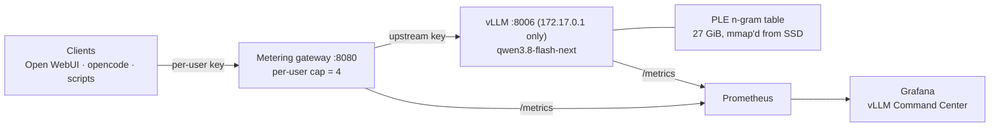
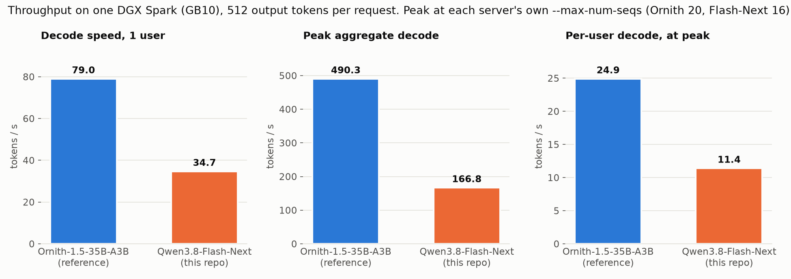
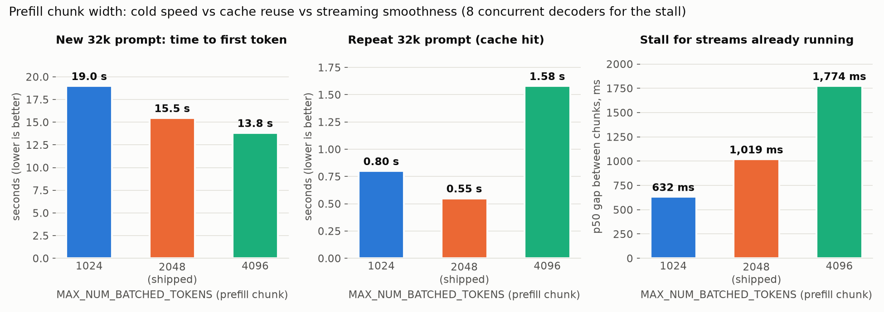
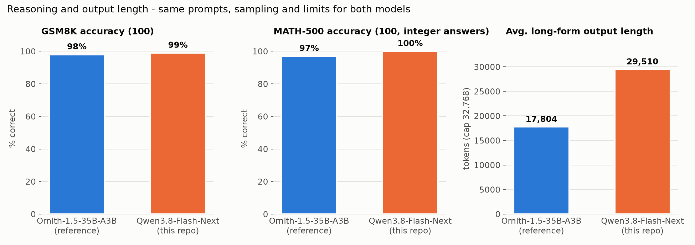

# Qwen3.8-Flash-Next (NVFP4 + FP8 KV + MTP) on NVIDIA DGX Spark (GB10)

A tested serving profile for **Qwen3.8-Flash-Next** on a single DGX Spark, wired
into a per-user metering gateway and a Prometheus/Grafana stack, with throughput
and prefill benchmarks against the box's previous production model,
[Ornith-1.5-35B-A3B](https://github.com/Hitheshkaranth/Ornith-1.5_A3B_Model_DGX_Spark_Setup).

## Overview

| | |
|---|---|
| Model | `Qwen/Qwen3.8-Flash-Next` (arch `qwen4_exp`: QSA sparse attention + Gated DeltaNet, 512 experts top-10, MTP head, vision tower) |
| Checkpoint | [`local-inference-lab/Qwen3.8-Flash-Next-NVFP4`](https://huggingface.co/local-inference-lab/Qwen3.8-Flash-Next-NVFP4), 99 GiB |
| Engine | `vllm/vllm-openai:qwen38-flash-next` via [MiaAI-Lab's single-Spark recipe](https://github.com/MiaAI-Lab/Qwen3.8-Flash-Next-Single-DGX-Spark) (pinned `b7c5da1`) |
| Served as | `qwen3.8-flash-next` on `172.17.0.1:8006` (gateway `:8080`) |
| Context | 262,144 tokens native, FP8 KV, ~850k KV tokens total (≈3.3 full-length sessions) |
| Concurrency | `MAX_NUM_SEQS=16`, peak 166.8 tok/s aggregate |
| Prefill | ~2,100 tok/s cold; ~0.5–0.8 s TTFT on a prefix-cache hit |
| Cold start | ~12 min to ready |

**Read this first:** Flash-Next is a much larger model than Ornith and takes
almost the whole box (GMU 0.753, ~105 GiB used). On one Spark it is **~2.3x
slower to decode for a single user and ~2.9x lower in peak aggregate** than
Ornith. Choose it for answer quality on long-context work, not for serving 20
users at once. Only one of the two fits in memory at a time.

## Table of Contents

- [Architecture](#architecture)
- [Requirements](#hardware--software-requirements)
- [Quick Start](#quick-start)
- [Configuration Reference](#configuration-reference)
- [Hosting on This System](#hosting-on-this-system)
- [Metering Gateway](#metering-gateway)
- [Benchmarks](#benchmarks)
- [TensorFold Comparison](#tensorfold-comparison)
- [Prefill Tuning](#prefill-tuning)
- [Live Monitoring](#live-monitoring)
- [Repository Layout](#repository-layout)
- [Troubleshooting](#troubleshooting)
- [Credits & License](#credits--license)

## Architecture

This repo is a thin layer: `install.sh` clones the upstream recipe into
`./upstream` at a pinned commit, applies `patches/`, drops in
`config/flash-next.env` as its `.env`, and runs its `download.sh` / `start.sh`.



## Hardware & Software Requirements

- DGX Spark / GB10 with 121 GiB unified memory (the memory budget is sized for it)
- ~150 GiB free disk: 99 GiB weights + 27 GiB packed PLE cache + 20 GiB image
- Docker with the NVIDIA Container Toolkit
- No other large GPU tenant: stop any other vLLM first

## Quick Start

```bash
git clone https://github.com/Hitheshkaranth/Qwen3.8-Flash-Next_Model_DGX_Spark_Setup.git
cd Qwen3.8-Flash-Next_Model_DGX_Spark_Setup
./gateway/setup.sh        # optional but recommended: generates the upstream key, :8080 service
./install.sh              # clone recipe, patch, download ~120 GiB, start, warm up
```

`install.sh` is re-runnable. `SKIP_START=1 ./install.sh` downloads only.
After any restart run `./scripts/warmup.sh`: the first prompt on a fresh
server takes ~1.5 s longer (8k tokens: 5.3 s vs 3.8 s) while the PLE pages
come in from SSD.

Test it:

```bash
curl -s http://localhost:8080/v1/chat/completions \
  -H "Authorization: Bearer <your gateway key>" -H 'Content-Type: application/json' \
  -d '{"model":"qwen3.8-flash-next","messages":[{"role":"user","content":"Say hi in 5 words."}]}'
```

The response carries the model's reasoning in `message.reasoning` and the
answer in `message.content`.

## Configuration Reference

Everything lives in `config/flash-next.env` (the upstream `.env` with every
comment kept). The values this profile changes or depends on:

| Variable | Value | Why |
|---|---|---|
| `TP1_MODEL_ID` | `local-inference-lab/Qwen3.8-Flash-Next-NVFP4` | the recipe's default `Mia-AiLab/...` repo returns 404 |
| `MAX_NUM_SEQS` | `16` | the recipe ships 4; 16 is the measured aggregate peak (20 is slower, see below) |
| `MAX_NUM_BATCHED_TOKENS` | `2048` | prefill chunk; measured trade-off in [Prefill Tuning](#prefill-tuning) |
| `HOST_RESERVE_GIB` | `30` | caps the GPU budget at 91.6 GiB (GMU 0.753); leaves the host and PLE page cache room |
| `MTP_NUM_SPECULATIVE_TOKENS` | `3` | recipe default |
| `KV_CACHE_DTYPE` | `fp8` | recipe default |
| `PORT` / `BIND` | `8006` / `172.17.0.1` | reachable from the host and from Docker (Prometheus), not from the LAN |
| `API_KEY` | from `gateway/upstream.key` | only the gateway can call vLLM |
| `TP1_CONTAINER_NAME` | `vllm-qwen38-flash` | |

`patches/0001-download-pass-HF_HUB_DISABLE_XET.patch` passes
`HF_HUB_DISABLE_XET` into the download container. Hugging Face Xet transfers
stalled repeatedly on this box; `install.sh` sets it to 1.

The container has **no Docker restart policy** (the recipe ships its own
systemd supervisor units in `upstream/systemd/`, not installed here), so
nothing comes back after a reboot until you run `upstream/start.sh`.

## Hosting on This System

On the reference box Flash-Next replaced Ornith on 2026-10-09:

```bash
# Ornith -> Flash-Next
docker update --restart no vllm-ornith-a3b && docker stop vllm-ornith-a3b
(cd upstream && ./start.sh) && ./scripts/warmup.sh

# Flash-Next -> Ornith
(cd upstream && ./stop.sh)
docker update --restart unless-stopped vllm-ornith-a3b && docker start vllm-ornith-a3b
```

`stop.sh` stops gracefully so vLLM can unlink its `/dev/shm` segments (the
container runs with `--ipc host`). The gateway lists every backend in
`GATEWAY_BACKENDS` and routes by model name, so both ports can stay listed.

Open WebUI keeps its default model in its own sqlite `config` table, which
overrides the `DEFAULT_MODELS` env var. Change it in Admin → Settings →
Models after swapping.

## Metering Gateway

`gateway/` is the same per-user / per-device token-metering proxy as the
Ornith repo (full guide: [`docs/GATEWAY.md`](docs/GATEWAY.md)), with one
addition:

- **`GATEWAY_MAX_PER_USER`** (default `4` in `setup.sh`, `0` = off): at most N
  in-flight requests per user; extras wait at the gateway instead of taking
  vLLM slots. With only 16 slots, one agent firing parallel requests could
  otherwise push every other user into the queue. Open WebUI users are counted
  separately (by forwarded e-mail); every other key counts as one user.

Overhead is ~2% (16 users: 166.8 tok/s via the gateway, 169.6 direct).

## Benchmarks

All numbers from 2026-10-09 on the reference box, on a live server with light
background traffic. Raw output in `benchmarks/*_console.log` and `*.jsonl`;
charts regenerate with `python3 benchmarks/make_charts.py`.

### Throughput & MTP



`benchmarks/throughput_bench.py` (same script as the Ornith repo): 512 forced
output tokens per request, temperature 0.6, via the gateway.

| Users | Aggregate tok/s | Per-user tok/s | Ornith aggregate |
|---|---|---|---|
| 1 | 34.7 | 34.8 | 79.0 |
| 8 | 115.1 | 14.7 | – |
| 16 | **166.8** | 11.4 | 438.8 |
| 20 | 124.2 | 9.9 | **490.3** |

- Peak is at `MAX_NUM_SEQS=16`; at 20 the extra 4 queue and aggregate drops.
- This matches the recipe's own 162.9 tok/s at 8 streams for prose; it is the
  model on this hardware, not a misconfiguration.
- MTP draft acceptance on this prose prompt was **36%** (Ornith: ~87%). The
  drafter uses a reduced English+code vocabulary
  (`files/draft_vocab_en_code_47k.txt`), so code-heavy traffic should accept
  more.

### Prefill



`benchmarks/prefill_bench.py`: **cold** prompts start with a unique nonce, so
nothing comes from the prefix cache; **warm** resends the same prompt; TTFT is
measured with `max_tokens=1`. The **stall** column has 8 streams decoding when
one cold 32k prompt arrives, and reports their gap between streamed chunks
while it prefills (quiet baseline ~120–155 ms).

| Chunk | Cold 8k | Cold 32k | Cold 64k | Cold tok/s | Warm 32k | Stall p50 | KV tokens |
|---|---|---|---|---|---|---|---|
| 1024 | 4.83 s | 19.0 s | 38.6 s | 1,690 | 0.80 s | 632 ms | 972k |
| **2048** | **3.79 s** | **15.5 s** | **31.6 s** | **2,080** | **0.55 s** | **1,019 ms** | 851k |
| 4096 | 3.51 s | 13.8 s | 28.1 s | 2,320 | 1.58 s | 1,774 ms | 868k |

### Reasoning & Output Length



`benchmarks/reasoning_bench.py` (same prompts, sampling and limits as the
Ornith repo): thinking on, temperature 0.6 / top_p 0.95 / top_k 20, 16 in
flight, max_tokens 16,384 for math and 32,768 for long-form. Sent directly to
`:8006` so the gateway's per-user cap doesn't throttle it to 4.

| | Flash-Next | Ornith |
|---|---|---|
| GSM8K (100) | **99%**, 469 tok avg, 354 s | 98%, 384 tok avg, 122 s |
| MATH-500 (100 integer answers) | **100%**, 1,342 tok avg, 0 truncated, 905 s | 97%, 1,937 tok avg, 3 truncated, 626 s |
| Long-form, 4 prompts | 29,510 tok avg, 3 of 4 hit the 32k cap | 17,804 tok avg, 1 hit the cap |

- Flash-Next is at the ceiling on both math sets and solves MATH-500 in ~30%
  fewer tokens than Ornith, but still takes longer on the clock because it
  decodes ~3x slower.
- It writes far longer when asked to write at length; set a `max_tokens`
  budget for long-form clients.
- Both math sets are near-saturated for these models, so they confirm the
  quantized model reasons correctly rather than separating the two models.

## TensorFold Comparison

The upstream authors now recommend their
[TensorFold recipe](https://github.com/MiaAI-Lab/Qwen3.8-Flash-Next-Single-DGX-Spark-TensorFold):
a Zig engine serving `azampatti/Qwen3.8-Flash-Next-125B-A5B-INT4-AutoRound`
(GPTQ int4, **5 active experts instead of 10**, 65.7 GiB in memory). Tested on
the same box on 2026-10-09 with the same scripts
(`benchmarks/tensorfold_result.json`, `reasoning_result_tensorfold.json`):

| | vLLM NVFP4 (this repo) | TensorFold INT4 |
|---|---|---|
| Decode, 1 user | 34.7 tok/s | **53.1** |
| Decode, 8 users | 115.1 tok/s | **220.0** |
| Max concurrent | 16 (166.8 tok/s) | 8 by default; **16 → 395.8 tok/s** (24.7 per user) |
| Cold 32k / 64k prompt | 15.5 s / 31.6 s | 14.5 s / 26.5 s |
| Repeat 64k prompt (cache hit) | 1.72 s | **0.20 s** |
| Other streams while a 32k prompt prefills | ~1 s steps | **frozen ~12.8 s** |
| GSM8K / MATH-500 | 99% / 100% | 99% / 99% (1 truncated) |
| Tokens per MATH-500 answer | **1,342** | 1,500 |
| Long-form avg | 29,510 tok | 28,592 tok |
| Cold start | ~12 min | **2 min** |
| `response_format` (structured output) | yes | no (HTTP 400) |

- With `PARALLEL=16` (the recipe's maximum) TensorFold reached 395.8 tok/s at
  16 users, 2.4x vLLM at the same width (8 users: 265.6 tok/s).
- TensorFold decodes 1.5-1.9x faster and reuses its prefix cache almost
  perfectly, but it **pauses every running stream until a new prompt has been
  read**, so a 30-60k agent prompt freezes other users for 15-30 s.
- The two math sets don't separate the two builds (both at the ceiling); the
  authors' own harness puts INT4-AR ~10% below on general capability.
- Pick TensorFold for few users and short or repeated prompts; keep vLLM for
  mixed multi-user traffic with long fresh prompts.

## Prefill Tuning

What prefill time on this box is made of, and what moved it:

1. **The model's rate is the ceiling.** ~2,100–2,300 tok/s at any context
   up to 64k; a 64k prompt is ~30 s no matter what. The recipe's own sparkDash
   ladder agrees (2,200–2,314 tok/s at 8k–64k with a 2048 chunk).
2. **Prefix caching is the biggest lever and is already on**
   (`mamba_cache_mode=align`, 1,664-token blocks, MTP block-drop disabled).
   On the live server 80% of prompt tokens were cache hits, which is why the
   average prefill over real traffic was 2.3 s for 11.5k-token prompts.
   Keep system prompts stable: a timestamp or random ID near the top of a
   prompt invalidates everything after it. (Audit on the reference box: Open
   WebUI, opencode and the harness inject none.)
3. **Chunk width (`MAX_NUM_BATCHED_TOKENS`) is a three-way trade:**
   - 1024 → 2048: cold prefill +23%; stall for other streams 0.63 → 1.02 s.
   - 2048 → 4096: another +12% cold, but warm turns get *slower* (the last
     1,664-token cache block of each prompt is no longer reused: 0.55 → 1.58 s
     at 32k) and stalls reach 1.8 s. Agent traffic is mostly warm turns, so
     4096 is a net loss for it. **2048 ships.**
   - Larger chunks also cost KV (972k tokens at 1024 vs ~850–870k above it).
4. **Warm up after restart** (`scripts/warmup.sh`): removes a ~1.5 s
   first-request penalty.
5. **Queue time is part of TTFT.** Past 16 concurrent requests, new ones wait;
   `GATEWAY_MAX_PER_USER` keeps one heavy user from causing that.

Not yet tried (from the recipe's own notes): the native SM12x MoE backend
`flashinfer_b12x` (may help large-batch prefill; may not JIT on SM121), and a
profiler trace of one 64k prefill to see whether MoE GEMMs, QSA attention,
GDN or the PLE gather dominate.

## Live Monitoring

- `monitoring/prometheus-scrape.yml`: scrape jobs for `:8006` and the gateway.
- `monitoring/grafana-dashboard.json`: the **vLLM Command Center** dashboard,
  including a **Latency (Prefill / TTFT / Queue)** row (p50/p95/avg of
  `vllm:request_prefill_time_seconds`, `vllm:time_to_first_token_seconds`,
  `vllm:request_queue_time_seconds`) plus per-user token panels.
- `monitoring/gateway-bypass-alert.yml`: alert when requests reach vLLM without
  going through the gateway.

## Repository Layout

```
install.sh                    clone recipe @ pinned commit, patch, configure, download, start, warm up
config/flash-next.env         the tested .env (API key blank; filled by install.sh)
patches/                      local fixes applied to the upstream recipe
scripts/warmup.sh             wait for health, prefill one 8k prompt
benchmarks/                   throughput, prefill and reasoning benches, results, charts, make_charts.py
gateway/                      metering gateway (per-user keys, usage DB, per-user concurrency cap)
monitoring/                   Prometheus scrape config, Grafana dashboard, bypass alert
docs/GATEWAY.md               gateway guide
upstream/                     (created by install.sh; not committed)
```

## Troubleshooting

| Symptom | Fix |
|---|---|
| `download.sh` hangs mid-file | Xet stall: `HF_HUB_DISABLE_XET=1` (install.sh sets it) |
| Default `Mia-AiLab/...-NVFP4` 404 | use `TP1_MODEL_ID=local-inference-lab/Qwen3.8-Flash-Next-NVFP4` (set in config) |
| `start.sh` fails the memory budget | another GPU tenant is running; stop it (only one big model fits) |
| Health stays non-200 for ~12 min | normal cold start (weights, PLE registration, CUDA graph capture) |
| Grafana shows no `:8006` data after editing `prometheus.yml` with `sed -i` | `docker restart` Prometheus: SIGHUP re-reads the old inode of a single-file bind mount |
| `401` calling `:8006` directly | working as intended; go through `:8080` |
| Nothing serving after a reboot | no restart policy; run `upstream/start.sh` (or install the recipe's systemd units) |
| Streams stutter when someone sends a huge prompt | expected with chunked prefill; lower `MAX_NUM_BATCHED_TOKENS` to 1024 for smoother streaming at −19% cold prefill |

## Credits & License

- Serving recipe, image integration, PLE offload, MTP patches:
  [MiaAI-Lab/Qwen3.8-Flash-Next-Single-DGX-Spark](https://github.com/MiaAI-Lab/Qwen3.8-Flash-Next-Single-DGX-Spark) (AGPL-3.0).
- NVFP4 checkpoint: [local-inference-lab](https://huggingface.co/local-inference-lab/Qwen3.8-Flash-Next-NVFP4).
- Model: Qwen team.
- This repo ships a patch to and configuration for the AGPL-3.0 recipe and is
  released under the same license (`LICENSE`).
